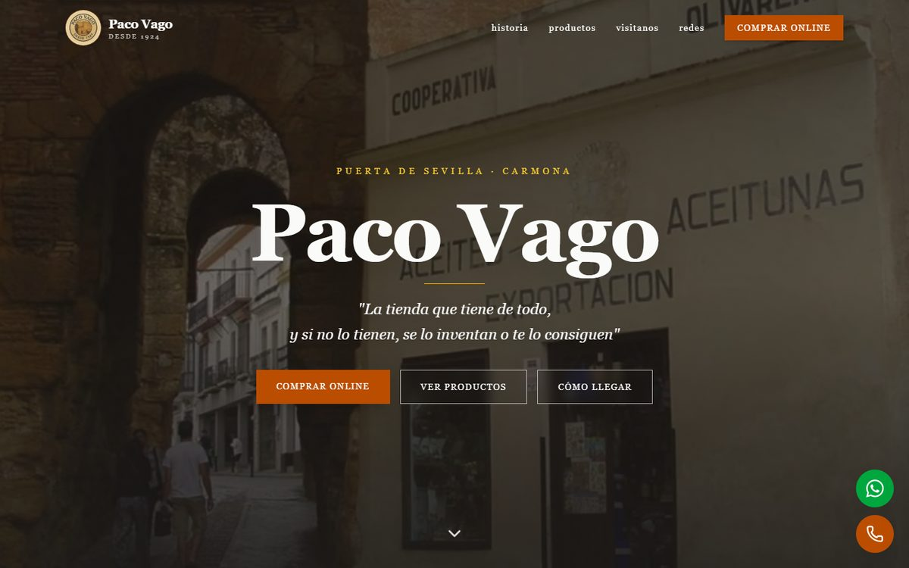
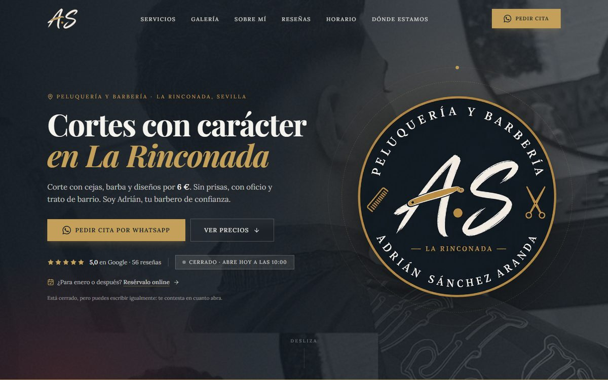

<!-- ═══════════════════════════ CABECERA ═══════════════════════════ -->
<div align="center">


<a href="https://github.com/albertocalerocastillo">
  
</a>

<p>
  <a href="https://www.linkedin.com/in/alberto-calero-castillo-405373257/"></a>
  <a href="mailto:albertocctrabajo@gmail.com"></a>
  
  
</p>

</div>

<!-- ═══════════════════════════ SOBRE MÍ ═══════════════════════════ -->
## 👋 Sobre mí

Soy **desarrollador Full Stack en Sevilla**. En el trabajo construyo aplicaciones con **React y C# / .NET**, y por mi cuenta diseño, desarrollo y mantengo **webs que usan negocios reales todos los días**: una tienda centenaria que ahora vende online, una barbería con reserva de citas y panel de gestión, una asesoría de nutrición…

Me gusta llevar los proyectos **de principio a fin**: hablar con el cliente, diseñar, programar, desplegar y seguir cuidándolos después. Y me obsesionan los detalles que no se ven: que cargue rápido, que Google lo entienda, que se pueda usar con teclado y que los datos estén a salvo.

```ts
const alberto = {
  rol: "Full Stack Developer",
  base: "Sevilla, España 🇪🇸",
  diaADia: ["React", "TypeScript", "C# / .NET"],
  proyectosPropios: ["React 19", "Vite", "Tailwind CSS", "Supabase", "Stripe", "Motion"],
  formacion: ["Técnico Superior en DAM", "Training React Full Stack · OXYGEN"],
  aprendiendo: ["Clean Architecture en .NET", "Diseño de APIs", "AWS"],
  meImporta: ["rendimiento", "SEO", "accesibilidad AA", "seguridad", "código que se entiende"],
};
```

<!-- ═══════════════════════════ PROYECTOS ═══════════════════════════ -->
## 🚀 Proyectos en producción

> Webs hechas para clientes reales y en uso hoy. Diseño, desarrollo, despliegue y mantenimiento: de principio a fin.

<table>
<tr>
<td width="50%" valign="top">

<a href="https://pacovago.es">
  
</a>

### 🛒 Paco Vago · Tienda online
**Tienda centenaria (desde 1924)** en la Puerta de Sevilla de Carmona, que pasa de no tener web a **vender online**.

- Tienda con carrito, ficha con zoom y **pago con tarjeta (Stripe)**
- **Portes calculados por peso** y reparto gratis en Carmona
- **Panel de administración** propio: productos, precios, fotos, pedidos y envíos
- SEO por ruta, datos estructurados de producto y sitemap generado
- Imágenes optimizadas: de **11 MB a 4 MB**


**[🌐 pacovago.es](https://pacovago.es)** · **[📂 Código](https://github.com/albertocalerocastillo/paco-vago)**

</td>
<td width="50%" valign="top">

<a href="https://adrian-barber.vercel.app">
  
</a>

### 💈 A.S Barbería · Reservas y gestión
Web de una **barbería en La Rinconada** (★ 5,0 en Google) con **reserva de citas online** y panel para el barbero.

- **Motor de reservas**: calendario, huecos libres y dobles reservas bloqueadas en la propia BD
- **Panel `/admin`**: agenda del día, citas, horarios, días libres y servicios
- **Seguridad**: Row Level Security, roles en Postgres, límite anti‑spam y cabeceras HTTP
- Animaciones con **Motion** que respetan *reducir movimiento*
- SEO local: JSON‑LD de negocio, `FAQPage` y horario desde una única fuente


**[🌐 Ver web](https://adrian-barber.vercel.app)** · **[📂 Código](https://github.com/albertocalerocastillo/adrian-barber)**

</td>
</tr>
<tr>
<td colspan="2" valign="top">

### 🥗 M y F Asesorías · *en desarrollo*
Web de una **asesoría online de nutrición y entrenamiento**. Es una SPA de React, pero con **prerenderizado propio (SSG)**: cada página sale como HTML completo para Google y las redes, y React solo la “hidrata” en el navegador.

`TypeScript` · `SSG propio` · `schema.org (Recipe, FAQPage, BlogPosting…)` · `AVIF/WebP responsive con sharp` · `View Transitions API` · `Motion` · `contraste AA` · `Cloudflare Workers`

**[📂 Código](https://github.com/albertocalerocastillo/myf-asesorias)**

</td>
</tr>
</table>

<!-- ═══════════════════════════ TRAINING ═══════════════════════════ -->
## 🎓 Training React Full Stack · OXYGEN

Formación intensiva por *sprints*: cada uno, un proyecto completo con su stack.

| Proyecto | Qué es | Stack | Demo |
|---|---|---|:---:|
| **[Hotel Miranda · Dashboard](https://github.com/albertocalerocastillo/OXYGEN_HotelMiranda_Dashboard)** | Panel de gestión de un hotel: reservas, habitaciones, usuarios y contacto | React · TypeScript · Redux Toolkit · styled‑components · Jest · Cypress · GitHub Actions → S3 | [🌐](http://oxygenhotelmirandadashboard.s3-website.eu-west-3.amazonaws.com) |
| **[Hotel Miranda · API REST](https://github.com/albertocalerocastillo/OXYGEN_HotelMiranda_REST)** | API del dashboard, con autenticación y documentación | Node · Express · TypeScript · MongoDB · MySQL · JWT · Joi · Swagger · Supertest | — |
| **[Hotel Miranda · Web](https://github.com/albertocalerocastillo/OXYGEN_HotelMiranda)** | Web pública del hotel, maquetada a partir de un diseño | HTML · CSS | [🌐](https://albertocalerocastillo.github.io/OXYGEN_HotelMiranda/) |
| **[OXYGEN Gallery](https://github.com/albertocalerocastillo/OXYGENGallery)** | Buscador de fotos con favoritas, edición y descarga | React · Redux Toolkit · API de Unsplash · AWS S3 | [🌐](http://oxygengallery.s3-website.eu-west-3.amazonaws.com/) |
| **[OXYGEN Laravel](https://github.com/albertocalerocastillo/OXYGEN_Laravel)** | Aplicación MVC del hotel | Laravel · PHP · Blade · Tailwind · Alpine.js | — |
| **[OXYGEN PHP](https://github.com/albertocalerocastillo/OXYGEN_PHP)** | Habitaciones del hotel en PHP sin framework | PHP · BladeOne | — |
| **[OxygenShop](https://github.com/albertocalerocastillo/OxygenShop)** | Landing responsive con JavaScript vanilla | HTML · SCSS · JavaScript | [🌐](https://albertocalerocastillo.github.io/OxygenShop/) |

<!-- ═══════════════════════════ STACK ═══════════════════════════ -->
## 🛠️ Tecnologías

<table>
<tr>
<td align="center" width="140"><b>Frontend</b></td>
<td></td>
</tr>
<tr>
<td align="center"><b>Backend</b></td>
<td></td>
</tr>
<tr>
<td align="center"><b>Datos</b></td>
<td></td>
</tr>
<tr>
<td align="center"><b>Testing</b></td>
<td></td>
</tr>
<tr>
<td align="center"><b>Deploy y<br/>herramientas</b></td>
<td></td>
</tr>
</table>

<!-- ═══════════════════════════ CÓMO TRABAJO ═══════════════════════════ -->
## 🧭 Cómo trabajo

| | |
|---|---|
| ⚡ **Rendimiento** | Imágenes AVIF/WebP en varios tamaños, carga diferida, y mapas o fuentes solo cuando hacen falta. |
| 🔎 **SEO de verdad** | Título y descripción por ruta, datos estructurados schema.org, sitemap y prerenderizado cuando la SPA no basta. |
| ♿ **Accesibilidad** | Contraste AA, navegación con teclado y animaciones que respetan *reducir movimiento*. |
| 🔐 **Seguridad** | Row Level Security, claves fuera del frontend, validación en la base de datos y cabeceras HTTP. |
| 📱 **Mobile first** | Revisado sin scroll horizontal de 360 px a 1920 px antes de publicar. |
| 📝 **Documentado** | Cada proyecto lleva su `ESTADO.md` con decisiones y pendientes, para retomarlo en cualquier momento. |

<!-- ═══════════════════════════ ESTADÍSTICAS ═══════════════════════════ -->
## 📊 Actividad en GitHub

<div align="center">

<picture>
  <source media="(prefers-color-scheme: dark)" srcset="https://raw.githubusercontent.com/albertocalerocastillo/albertocalerocastillo/main/profile-summary-card-output/github_dark/0-profile-details.svg" />
  
</picture>

<picture>
  <source media="(prefers-color-scheme: dark)" srcset="https://raw.githubusercontent.com/albertocalerocastillo/albertocalerocastillo/main/profile-summary-card-output/github_dark/3-stats.svg" />
  
</picture>
<picture>
  <source media="(prefers-color-scheme: dark)" srcset="https://raw.githubusercontent.com/albertocalerocastillo/albertocalerocastillo/main/profile-summary-card-output/github_dark/2-most-commit-language.svg" />
  
</picture>

<picture>
  <source media="(prefers-color-scheme: dark)" srcset="https://streak-stats.demolab.com?user=albertocalerocastillo&theme=github-dark-blue&hide_border=true&background=0D111700&locale=es" />
  
</picture>

<br/><br/>

<picture>
  <source media="(prefers-color-scheme: dark)" srcset="https://raw.githubusercontent.com/albertocalerocastillo/albertocalerocastillo/output/github-contribution-grid-snake-dark.svg" />
  
</picture>

</div>

<!-- ═══════════════════════════ PIE ═══════════════════════════ -->
<div align="center">

### ¿Tienes un proyecto en mente?

Si tu negocio necesita web, tienes una idea que quieres sacar adelante o un puesto donde encaje,<br/>
**escríbeme y lo hablamos** ☕

<a href="mailto:albertocctrabajo@gmail.com"></a>


</div>
